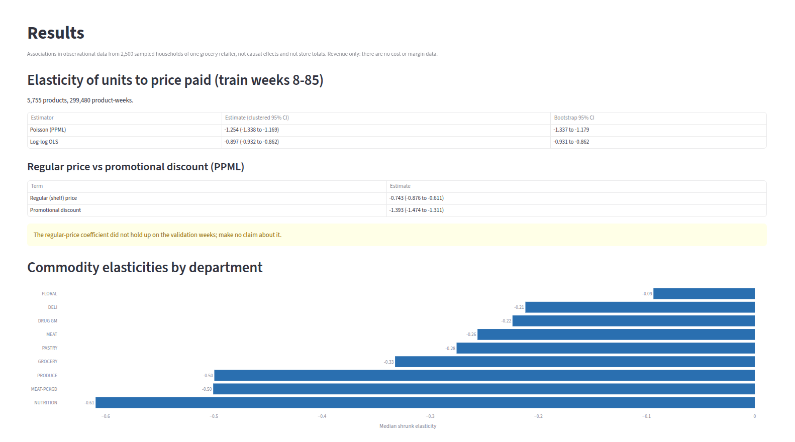
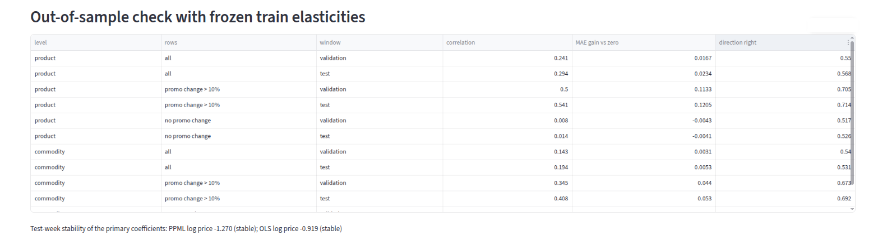
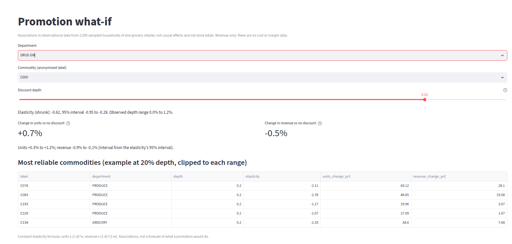

# Price elasticity and promotion analysis

How does weekly unit demand move with the price paid and with promotions, in grocery retail? This project builds a weekly price/promotion panel from the dunnhumby *The Complete Journey* transactions, estimates elasticities with fixed-effects Poisson and log-log OLS models, checks them against pre-registered robustness, stability and out-of-sample tests, and offers a promotion what-if tool. **Everything here is an association in observational data, not a causal effect.**

## Data

Source: dunnhumby, *The Complete Journey* (transactions of 2,500 frequent shoppers of one retailer over two years, plus product, promotion, coupon and demographic tables). The copy used is the Kaggle mirror `frtgnn/dunnhumby-the-complete-journey`, which lists the licence as **DbCL-1.0**; check dunnhumby's own terms before reuse. **The data is not included in this repository**: download it, unzip it, and set `DUNNHUMBY_RAW_DIR` (default `~/Downloads/dunnhumby-raw`). The repo ships code and aggregate results only.

Panel built in step 1 (`docs/panel_audit.md`): 2,595,732 transaction rows, 2,500 households, 91,905 products, 307 commodities, 102 weeks; panel totals reconcile exactly to the source rows. Fuel, coupon and placeholder items are flagged and excluded from analysis. Weeks are split into train (1-85), validation (86-93) and test (94-101); the test weeks were evaluated once.

## Method and pre-registration

- `docs/analysis_plan.md` (committed before any model was fitted) fixes the price variable, sample, estimators, robustness list and stability rule.
- `docs/test_protocol.md` (committed before any test-week row was read) freezes the train estimates and the out-of-sample task.
- Price = unit price paid after the loyalty discount, before the manufacturer coupon. Poisson pseudo-maximum-likelihood with product and week fixed effects, standard errors clustered by product, plus a 500-resample cluster bootstrap; log-log OLS as a cross-check.
- Commodity level: fixed-weight price index (so pack-size mix shifts do not look like price changes), per-commodity Poisson fits, empirical-Bayes shrinkage.

## Results (train weeks 8-85)

Primary sample: 5,755 products, 299,480 product-weeks, with at least 30 active weeks and enough promotion variation.

| Estimator | Elasticity of units to price paid | Bootstrap 95% CI |
|---|---|---|
| Poisson (PPML) | -1.25 (95% CI -1.34 to -1.17) | -1.34 to -1.18 |
| Log-log OLS | -0.90 (95% CI -0.93 to -0.86) | -0.93 to -0.86 |

A 1% lower price paid goes with roughly 0.9% to 1.3% more units, depending on the estimator.

Splitting price into regular (shelf) price and promotional discount (PPML): regular price -0.74 (95% CI -0.88 to -0.61), promotional discount -1.39 (95% CI -1.47 to -1.31). Units look more sensitive to promotional discounts than to regular price changes, but the regular-price coefficient was not stable on the validation weeks (see below), so nothing is claimed about it.

Commodity level (248 commodities): pooled PPML -0.61 (95% CI -0.81 to -0.41); per-commodity median -0.28 after shrinkage (-0.26 unshrunk). 65 commodities have a positive point estimate (10 with an interval above 0), reported as found and not adjusted. Per-commodity results by department are in `evals/results/elasticity_train.md`.

## Robustness (PPML, primary term)

| Variant | Estimate (SE) | Change vs primary |
|---|---|---|
| Primary | -1.254 (0.043) | |
| Include start-up weeks 2-7 | -1.250 (0.043) | +0.004 |
| Drop display and mailer controls | -1.801 (0.054) | -0.548 |
| Winsorise units at p99 | -1.031 (0.028) | +0.223 |
| Drop top 1% volume products | -1.150 (0.029) | +0.104 |
| Drop low-household weeks | -1.287 (0.044) | -0.033 |
| Placebo: future price, lead 1 / lead 2 | -0.018 (0.040) / -0.057 (0.028) | expected near 0 |

## Stability across time (14 of 18 coefficients stable)

Re-estimating on validation weeks 86-93 alone (rule fixed in advance: same sign and overlapping 95% CIs): primary log price -1.37 vs -1.25 on train; promotional discount -1.59 vs -1.39; regular price -0.14 vs -0.74 (interval -0.33 to 0.05). Not stable: PPML x_base, PPML share_stores_display, OLS x_base, commodity-pooled PPML log price index.

## Out-of-sample check and one-time test evaluation

Task: predict each product's (and commodity's) week-over-week change in log units from its change in log price paid, using the frozen train elasticities, after removing the common weekly change (cross-product mean subtracted from actual and predicted). Baselines: no relative change; last week's relative change repeats.

| Product level | Validation 86-93 | Test 94-101 |
|---|---|---|
| Correlation, predicted vs actual | 0.241 (0.216 to 0.264) | 0.294 (0.273 to 0.316) |
| MAE gain vs zero baseline | 0.017 (0.013 to 0.020) | 0.023 (0.020 to 0.027) |
| MAE gain vs last-week baseline | 0.521 (0.510 to 0.532) | 0.531 (0.520 to 0.541) |
| Direction right | 0.550 (0.542 to 0.558) | 0.568 (0.561 to 0.575) |

Commodity level on the test weeks: correlation 0.194 (0.096 to 0.281), MAE gain vs zero 0.005 (0.000 to 0.011). The gain is concentrated in product-weeks with a promotional discount change above 10% (test correlation 0.541 (0.514 to 0.568), MAE gain vs zero 0.121 (0.108 to 0.135)); in the other weeks the correlation is 0.014 (-0.005 to 0.031) and the MAE gain vs zero is -0.004 (-0.006 to -0.002), i.e. no better than predicting no relative change. The last-week-repeats baseline is much worse than predicting zero because weekly changes mean-revert.

Primary coefficients re-estimated on the 8 test weeks: PPML log price -1.27 vs -1.25 on train (stable); OLS log price -0.92 vs -0.90 on train (stable). Nothing was changed after the test numbers were seen (`evals/results/test_run_record.json`).

## Promotion what-if simulator

For a commodity (anonymised label) and a discount depth inside its observed 5th-95th percentile range, the simulator returns the predicted change in units (depth d, elasticity e: units x (1-d)^e) and in revenue ((1-d)^(1+e)) relative to no discount, with an interval from the commodity's shrunk 95% elasticity interval. Commodities with a non-negative elasticity or an interval including 0 are flagged *not reliable* and not ranked. Revenue only: there are no cost or margin data. Example at 20% depth for the most reliable commodities:

| Commodity | Department | Elasticity | Units | Revenue |
|---|---|---|---|---|
| C078 | PRODUCE | -2.11 | +60.1% (+49.2 to +71.8) | +28.1% (+19.4 to +37.5) |
| C083 | PRODUCE | -1.78 | +48.8% (+36.3 to +62.6) | +19.1% (+9.0 to +30.1) |
| C193 | PRODUCE | -1.17 | +30.0% (+22.0 to +38.4) | +4.0% (-2.4 to +10.7) |

## App

`streamlit run app/streamlit_app.py` opens a Results page (estimates, department chart, robustness, stability, out-of-sample and test results) and a What-if page. Both read only the committed files in `evals/results/`; no data is needed.



*Results page: primary and split elasticities and median shrunk elasticity by department (screenshot of the local Streamlit app, which reads only committed result files).*



*Out-of-sample check on validation and test weeks (screenshot of the local Streamlit app, which reads only committed result files).*



*What-if page: the interval for the predicted change in units and revenue for a reliable commodity at a small discount, and the most reliable commodities at 20% depth (screenshot of the local Streamlit app, which reads only committed result files).*

## Limitations

- Observational data: prices and promotions respond to demand and season and are not randomised. No causal claim is made.
- About 79.5% of selling product-store-weeks have no promotion record, so display and mailer controls are incomplete. They matter: dropping them moves the primary PPML estimate from -1.25 to -1.80. Part of the promotional-discount coefficient may reflect unrecorded advertising or merchandising, so its magnitude may be overstated.
- The regular-price coefficient was not stable across time and should not be interpreted.
- Commodity-level estimates are noisy: 65 of 248 are positive.
- Only 2,500 sampled households of one retailer: units are sample counts, not store totals. Grocery, not fashion; findings do not transfer to apparel.
- Estimates are conditional on a product selling that week; weeks without sales are missing, not zero.
- Revenue, not profit: there are no cost data.

## Engineering

| Stage | Runtime (s) | Peak memory (MB) |
|---|---|---|
| Panel audit | | 1571 |
| Elasticity estimation, train (incl. 500-resample bootstraps) | 2076.3 | 2043 (main process) |
| Validation stability | 2.8 | 815 |
| Out-of-sample, validation | 4.2 | 467 |
| Test evaluation | 6.1 | 618 |

Peak memory is the main process's high-water mark from /proc; the product bootstrap ran in separate worker processes (3 at a time, each short-lived). Runtimes are wall-clock on a 7.5 GB laptop. Panel build/convert timings were not recorded. All scripts run a 1 GB available-memory watchdog. The suite has 28 test functions (synthetic data only).

## Reproduce

```bash
python3 -m venv .venv && .venv/bin/pip install -r requirements.txt
export PYTHONPATH=src DUNNHUMBY_RAW_DIR=/path/to/dunnhumby-raw
python scripts/convert_raw.py && python scripts/build_panel.py && python scripts/audit_panel.py
python scripts/run_elasticity.py && python scripts/run_validation.py        # train estimates, validation stability
python scripts/freeze_estimates.py && python scripts/run_oos_validation.py   # frozen estimates, out-of-sample check
python scripts/run_test_final.py --dry-run-on-validation                      # must reproduce the validation numbers
python scripts/run_test_final.py --i-am-done-tuning                           # once only
python scripts/collect_engineering.py && python scripts/make_readme.py
python -m pytest
```

## Licence

Code: MIT (see `LICENSE`). The dunnhumby data is not covered by this licence and is not distributed here.
